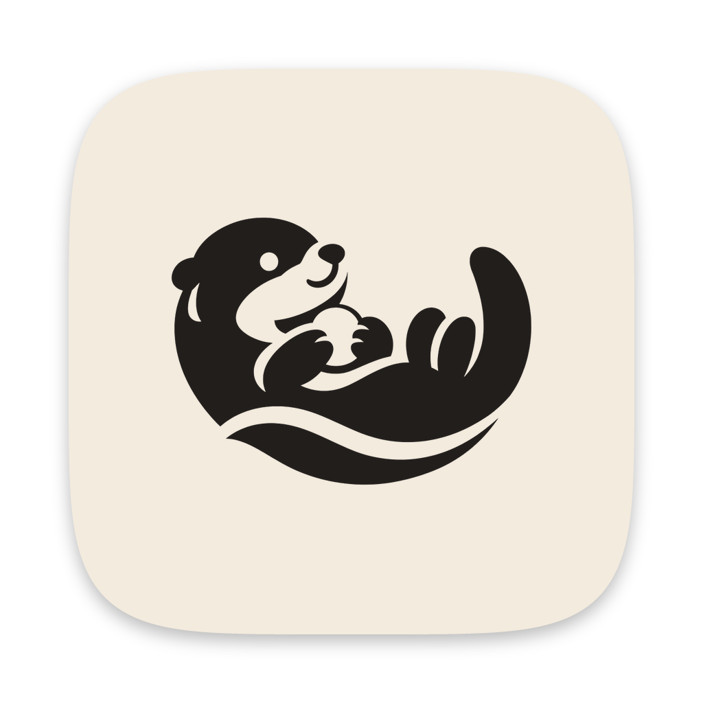
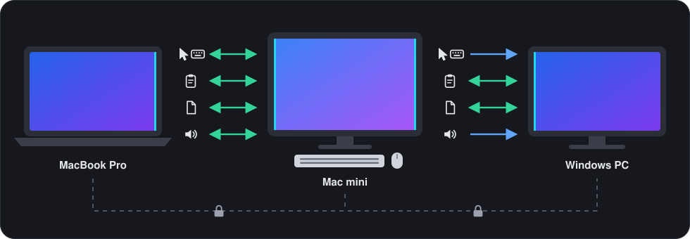
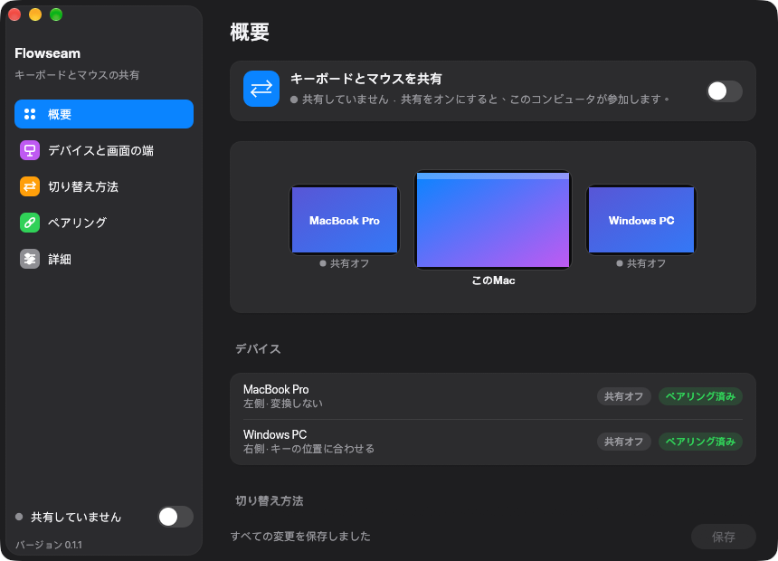
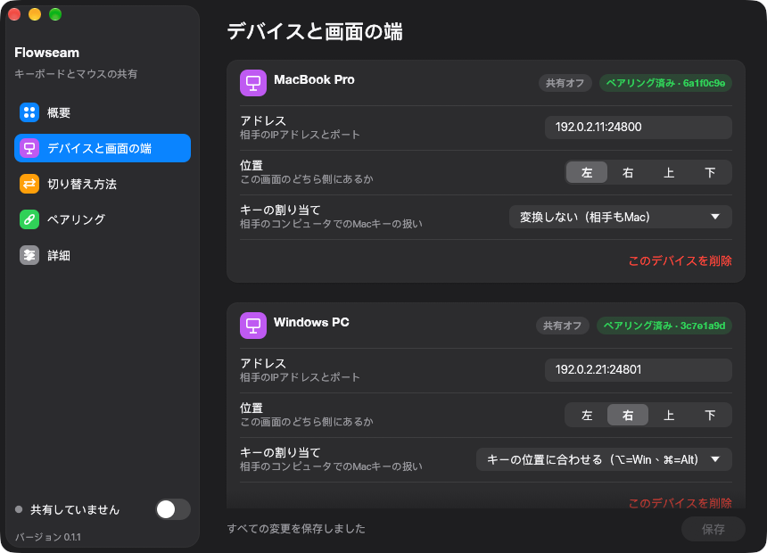
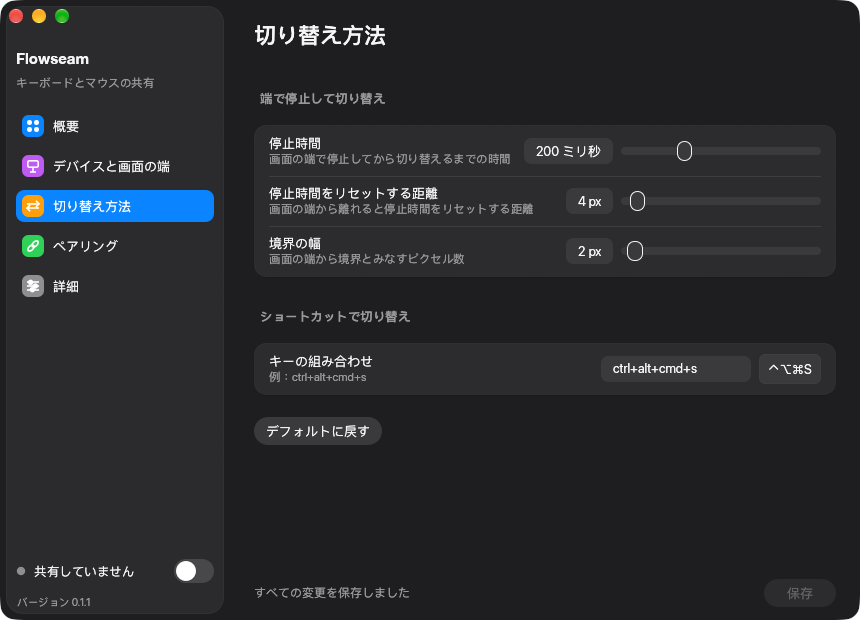
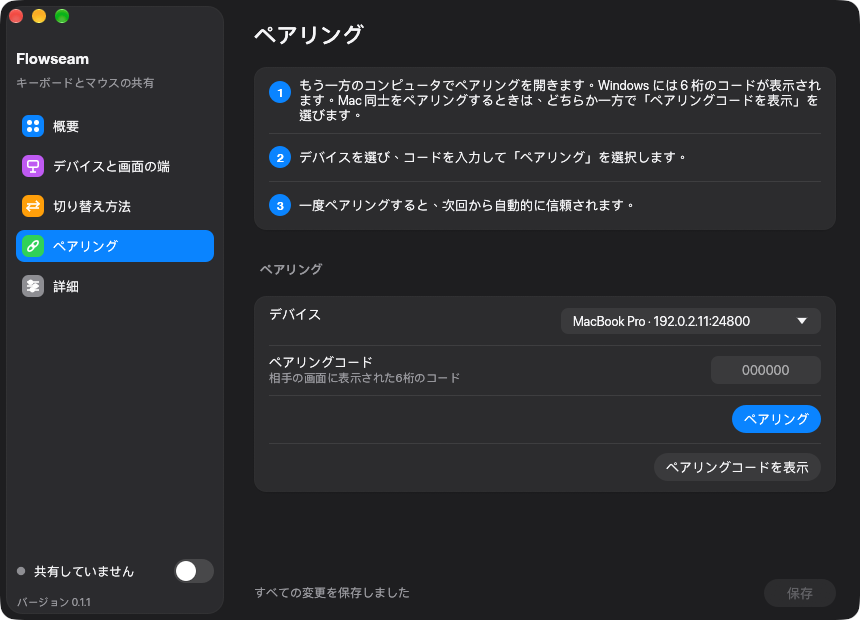
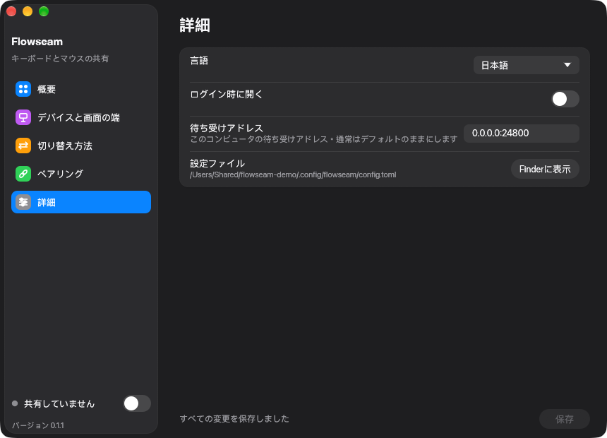
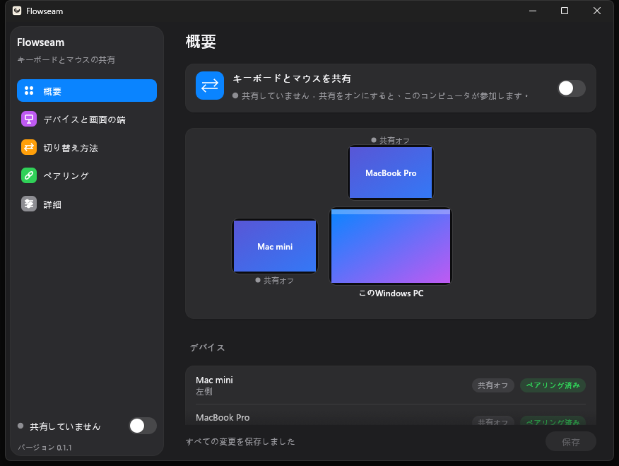

<!-- doctype: contract -->
<p align="center"></p>

<h1 align="center">Flowseam</h1>

<p align="center"><b>1 組のキーボードとマウスで、Mac と PC をまとめて操作。</b></p>

<p align="center"><a href="LICENSE"></a>   <a href="https://github.com/operonlab/flowseam/releases"></a></p>

<p align="center"><a href="README.md">English</a> · <a href="README.zh-TW.md">繁體中文</a> · 日本語 · <a href="README.ko.md">한국어</a></p>

ポインタを一方の画面の端から外へ動かすと、隣のコンピュータへ移ります。入力した内容もそのまま付いていき、クリップボードやドラッグしたファイルも同様です。マシン同士は直接やり取りするため、サーバーもアカウントも要りません。

https://github.com/user-attachments/assets/be5499eb-c39a-4722-b87a-0203b3a30c64

<sub>デモ動画のナレーションと音楽は ElevenLabs (elevenlabs.io) で生成しました。</sub>

> **ステータス：初期版（0.1）。** Mac 2 台と Windows PC 1 台で毎日使っています。粗い部分が残っているので、すべてのマシンを同じバージョンにそろえてください。

<p align="center"></p>

## 端をまたぐもの

| | Mac ↔ Mac | Mac ↔ Windows PC |
|---|:-:|:-:|
| ポインタとキーボード | ⇄ | → |
| クリップボードのテキスト | ⇄ | ⇄ |
| ファイル（放した場所にそのまま置かれます） | ⇄ | ⇄ |
| 音量キーとメディアキー | ⇄ | → |

⇄ 双方向 · → Mac からのみ。Windows PC は操作される側で、他のコンピュータを操作することはできません。Mac から操作している間は、Windows PC からファイルを戻せます。

## 他にない点

- **意図したときだけ切り替わる。** 共有している画面の端にポインタを 200 ms 置くか、⌃⌥⌘S を押すと切り替わります。マウスボタンを押している間はポインタが元の画面にとどまるため、ウィンドウのドラッグやテキストの選択中に隣のコンピュータへ飛び出すことはありません。ファイルのドラッグだけは例外です。
- **Mac を経由して次のコンピュータへ。** MacBook で Mac mini を操作しているとき、その先の Windows PC までそのまま操作できます。間の Mac がポインタとキー入力を転送します。
- **いつでも戻れる。** ⌃⌥⌘Esc を押すと、マウスとキーボードが Mac に戻ります。別のコンピュータが操作している Mac のマウスやキーボードに触れると、その Mac が操作を引き継ぎます。バックグラウンドのプロセスが固まった場合や、共有中に macOS が許可を取り消した場合も、入力はロックされたままにならず解放されます。
- **Windows で使える Mac のショートカット。** ⌘C でコピー、⌘Tab でアプリの切り替え、⌥ を単独で押すとスタートが開きます。[キーとショートカット](#キーとショートカット)を参照してください。
- **Mac 同士の最速接続。** 2 台の Mac が複数のネットワークでつながっている場合、Flowseam は最も速い経路を使います。Thunderbolt やイーサネットが Wi‑Fi より優先されます。
- **プライバシー重視。** ペアリングは 6 桁のコードで 1 回だけ行います。以降の接続はすべて、ご自身のマシン同士の相互 TLS です。テレメトリはありません。[プライバシーとネットワーク](#プライバシーとネットワーク)を参照してください。
- **邪魔にならない。** メニューバーのアイコン（Mac）またはトレイのアイコン（Windows）で、共有がオンかどうかとどのコンピュータが接続されているかを確認できます。ウィンドウを閉じても Flowseam は動き続けます。バックグラウンドのプロセスが終了したり応答しなくなったりした場合は、再起動されます。
- **4 言語対応。** English、繁體中文、日本語、한국어に対応し、システムの言語に従います。

## アプリ

| 概要 | デバイスと画面の端 |
|---|---|
|  |  |
| **切り替え方法** | **ペアリング** |
|  |  |
| **詳細** | **Windows PC の場合** |
|  |  |

## インストール

| | macOS 13 以降（Apple シリコンおよび Intel） | Windows 10 または 11 |
|---|---|---|
| 入手 | Homebrew、または [Releases](https://github.com/operonlab/flowseam/releases) の zip | [Releases](https://github.com/operonlab/flowseam/releases) の exe、またはソースからビルド（インストーラはまだありません） |
| 許可 | アクセシビリティと入力監視 | 求められたら Windows ファイアウォール（TCP 24800） |
| アップデート | `brew upgrade --cask flowseam` | 新しい exe をダウンロードして古いものと置き換える |

### macOS

```sh
brew install --cask operonlab/tap/flowseam
```

Flowseam を一度開いてください。macOS から**アクセシビリティ**と**入力監視**の許可を求められます（システム設定 › プライバシーとセキュリティ）。両方とも許可してください。すべてのリリースは同じ証明書で署名されているため、アップデートしても許可は維持されます。

Flowseam は独自の証明書で署名されており、Apple の公証は受けていません。Homebrew の cask では、ダウンロード時の隔離属性が自動的に解除されます。zip からインストールした場合、初回起動は macOS に拒否されます。システム設定 ›
プライバシーとセキュリティを開き、**「このまま開く」**を選択してください。

### Windows

[Releases](https://github.com/operonlab/flowseam/releases) から `Flowseam-<version>-windows-x64.exe` をダウンロードし、専用のフォルダ（例: `%LOCALAPPDATA%\Programs\Flowseam`）に置いて実行してください。exe は署名されていないため、初回は Windows SmartScreen が「Windows によって PC が保護されました」と表示します。**詳細情報**を選び、**実行**を選んでください。

自分でビルドする場合は、Rust（stable、MSVC ツールチェーン）を使います。

```powershell
git clone https://github.com/operonlab/flowseam
cd flowseam
cargo build --release -p flowseam
.\target\release\flowseam.exe
```

Flowseam は設定ウィンドウを開き、トレイにアイコンを表示します。求められたら Windows ファイアウォールで通信を許可してください。Mac は TCP ポート 24800 でこの PC に接続します。

## セットアップ

| | 場所 | すること |
|---|---|---|
| **1. 追加** | 各コンピュータの**デバイスと画面の端** | **＋ デバイスを追加**を選択します。名前、アドレス（ホスト名または IP）、そのコンピュータが接している画面の端を指定します。 |
| **2. ペアリング** | **ペアリング** | 一方がコードを表示し、もう一方が入力します。詳細は下記を参照してください。ペアリングは 1 回だけです。 |
| **3. 共有** | ウィンドウ、またはメニューバーのアイコン | **キーボードとマウスを共有**をオンにして、ポインタを画面の端の向こうへ動かします。 |

ペアリングでは、コードを表示する側のコンピュータ（Windows PC、または Mac 同士をペアリングする場合はどちらか一方の Mac）で、ペアリングが同じポートを使うため先に共有をオフにします。**ペアリング**を開いて相手のコンピュータを選び、**ペアリングコードを表示**を選択します。もう一方の Mac では**ペアリング**を開いて最初のコンピュータを選び、コードを入力して**ペアリング**を選択し、続けて**保存**を選択します。

## キーとショートカット

| Mac で | 動作 |
|---|---|
| 共有している端に 200 ms 置く | その側にあるコンピュータへ切り替わる |
| ⌃⌥⌘S | 端に置かずに切り替える。戻るときは、もう一方のコンピュータで再度押す |
| ⌃⌥⌘Esc | マウスとキーボードをこの Mac に取り戻す |

停止時間と切り替えのショートカットは**切り替え方法**で設定します。相手のコンピュータが Mac のキーをどう解釈するかは、コンピュータごとに**デバイスと画面の端 › キーの割り当て**で設定します。

| キーの割り当て | 用途 |
|---|---|
| 変換しない | 相手が Mac の場合 |
| キーの位置に合わせる（⌥=Win、⌘=Alt） | PC の場合。キーを PC のキーボードと同じ位置に合わせる |
| Macのショートカット | PC の場合。使い慣れたショートカットをそのまま使う |

**Macのショートカット**を選んだ場合：

| Mac で | PC では |
|---|---|
| ⌘ + キー、⌃ + キー | Ctrl + キー |
| ⌘Tab | Alt+Tab |
| ⌘Q | Alt+F4 |
| ⌘⇧Z | Ctrl+Y（やり直し） |
| ⌘← ⌘→ | Home, End |
| ⌥← ⌥→, ⌥⌫ | Ctrl+← Ctrl+→, Ctrl+Backspace |
| ⌘Space | Win+S（検索） |
| ⌃⌘Q | Win+L（ロック） |
| ⌘M | Win+↓（最小化） |
| ⌘⇧4, ⌘⇧5 | Win+Shift+S（スニップ） |
| ⌘⌥Esc | Ctrl+Shift+Esc（タスクマネージャー） |
| ⌥ を単独で押す | スタート |

完全な対応表は [`crates/flowseam-core/src/mac_shortcuts.rs`](crates/flowseam-core/src/mac_shortcuts.rs) にあります。

## プライバシーとネットワーク

| | 内容 |
|---|---|
| ペアリング | 1 回だけ。一方のコンピュータに表示された 6 桁のコードを、もう一方で入力する |
| 接続 | 相互 TLS。ペアリングしたコンピュータの証明書に固定される |
| 経路 | ローカルネットワーク、またはご自身で用意した SSH トンネル経由の直接通信。間にサーバーはない |
| ポート | TCP 24800 |
| テレメトリ | なし。アップデートを確認は Releases ページを開く。お使いのコピーを Homebrew でインストールした場合は Homebrew を実行する |

## 既知の制限

- Windows PC は操作される側にはなれますが、他のコンピュータを操作することはできません。
- クリップボードで扱えるのはテキストのみです。画像、リッチテキスト、ファイルは扱えません。
- Linux には対応していません。
- Windows にはインストーラがなく、exe も署名されていません。初回の実行時に SmartScreen が警告します。
- コンピュータは入力したアドレスで見つけます。ローカルネットワーク上の自動検出はまだありません。

## トラブルシューティング

| 問題 | 確認すること |
|---|---|
| ポインタが隣へ移らない | 共有がオンになっていること、両方のコンピュータが互いに接続済みと表示されていること、デバイスと画面の端で設定した端にポインタを押し当てていること。 |
| Mac で「システムの権限が必要です」と表示される | システム設定 › プライバシーとセキュリティ › アクセシビリティと入力監視で Flowseam をオンにし、いったん終了してから開き直してください。 |
| ログ | macOS：`~/Library/Logs/Flowseam/worker.log`。Windows：`%LOCALAPPDATA%\Flowseam\worker.log`。前回の実行分は `worker.log.1` として残ります。 |
| 設定とペアリング情報 | `~/.config/flowseam`（Windows では `%USERPROFILE%\.config\flowseam`）。 |

## ソースからビルド

Rust stable が必要です。`cargo test --workspace` は macOS と Windows で実行できます。`scripts/make-app.sh <version>` は
Apple シリコン版と Intel 版の両方の macOS アプリをビルドして署名します。コード署名用の ID と `cargo-about`
（`cargo install cargo-about --locked --features cli`）が必要です。

設計メモは [docs/](docs/) にあります。変更履歴は [CHANGELOG.md](CHANGELOG.md) にまとめてあります。

## ライセンス

[MIT](LICENSE)。Flowseam が使用しているオープンソースライブラリのライセンスは、アプリに同梱されています（`Flowseam.app/Contents/Resources/THIRD-PARTY-NOTICES.html`）。
