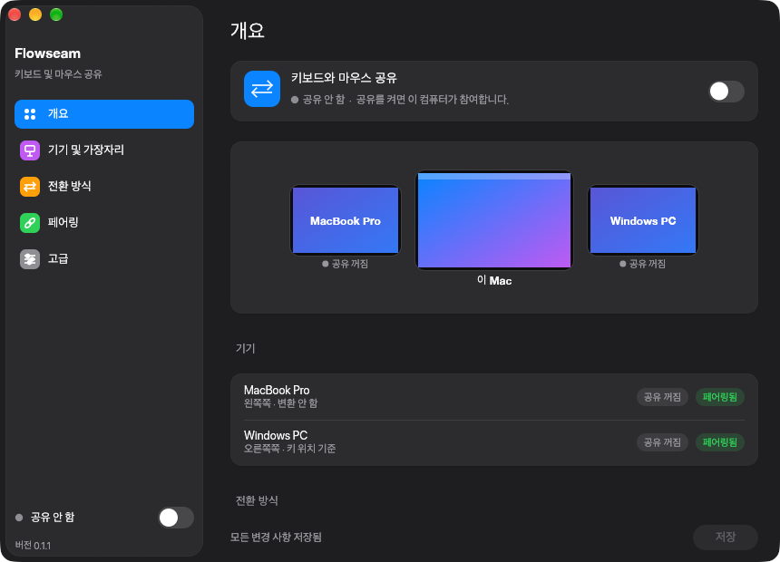
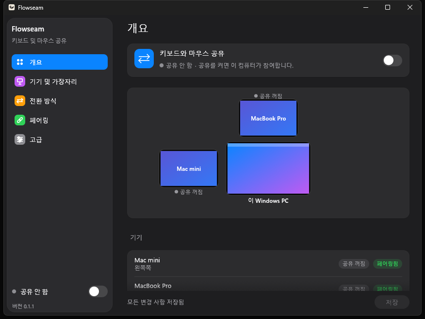
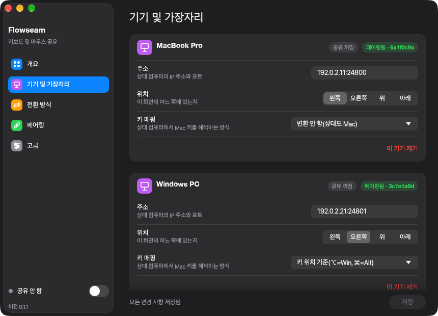
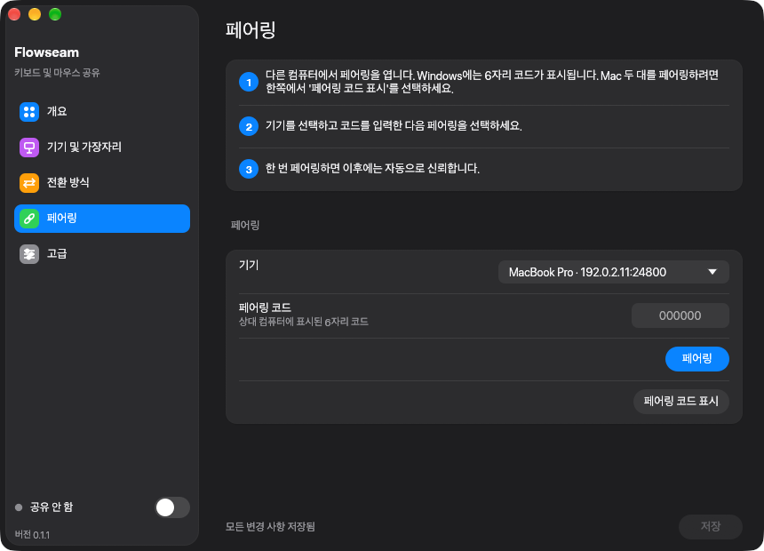

<!-- doctype: contract -->
# Flowseam

[English](README.md) · [繁體中文](README.zh-TW.md) · [日本語](README.ja.md) · **한국어**

Mac과 PC 여러 대를 마우스 하나와 키보드 하나로 사용합니다. 포인터를 한 화면의 가장자리 밖으로 밀면 다음
컴퓨터로 이어지고, 입력하는 내용은 포인터를 따라가며, 클립보드와 끌어다 놓는 파일도 함께 이동합니다.

https://github.com/user-attachments/assets/be5499eb-c39a-4722-b87a-0203b3a30c64

<sub>데모 영상의 내레이션과 음악은 ElevenLabs(elevenlabs.io)로 생성했습니다.</sub>

> **상태: 초기 단계(0.1).** Mac 두 대와 Windows PC 한 대에서 매일 사용하고 있습니다. 완성도가 거칠 수 있으니
> 모든 기기를 같은 버전으로 유지하세요.

## 기능

| | Mac ↔ Mac | Mac → Windows | Windows → Mac |
|---|---|---|---|
| 화면 가장자리를 넘나드는 마우스와 키보드 | 예 | 예 | 아니요: Windows PC는 제어받는 쪽이며 다른 컴퓨터를 제어하지 못합니다 |
| 클립보드 텍스트 | 예 | 예 | 예 |
| 가장자리를 넘어 파일 끌어다 놓기 | 예, 놓은 위치에 저장됩니다: 폴더, 데스크톱 또는 앱 | 예, 다운로드 폴더에 저장됩니다 | 아직 지원하지 않음 |
| 음량 및 미디어 키 | 예 | 예 | 아니요 |

- **전환.** 공유된 가장자리에 포인터를 잠시(기본 200 ms) 두거나 단축키(기본 ⌃⌥⌘S)를 누릅니다. 마우스
  버튼을 누르고 있는 동안에는 포인터가 현재 화면에 머물기 때문에, 창을 끌거나 텍스트를 선택하다가 다음
  컴퓨터로 넘어가는 일은 없습니다. 파일 끌어다 놓기만 예외입니다.
- **제어권 되찾기.** Mac에서 ⌃⌥⌘Esc를 누르면 언제든 마우스와 키보드가 Mac으로 돌아옵니다.
- **Windows에서 Mac 단축키 사용.** Mac으로 Windows PC를 제어할 때 단축키를 변환할 수 있습니다. ⌘C는 복사,
  ⌘Tab은 앱 전환, ⌥ 단독 입력은 시작 메뉴 열기입니다(기기 및 가장자리 › 키 매핑).
- **Mac 간 가장 빠른 연결.** 두 Mac이 둘 이상의 네트워크로 연결되어 있으면 Flowseam은 가장 빠른 쪽을
  사용합니다. Thunderbolt나 이더넷을 Wi‑Fi보다 우선합니다.
- **설계부터 프라이버시 우선.** 기기는 6자리 코드로 한 번만 페어링합니다. 이후의 모든 연결은 상호 TLS이며,
  페어링한 기기의 인증서에 고정됩니다. 어떤 것도 서버를 거치지 않습니다. Flowseam은 로컬 네트워크 또는
  직접 설정한 SSH 터널을 통해 통신합니다. 텔레메트리는 없으며, 업데이트 확인은 Releases 페이지를 열기만
  합니다.
- **방해하지 않는 동작.** 메뉴 막대 아이콘(Mac) 또는 트레이 아이콘(Windows)이 공유 켜짐 여부와 연결된 기기를
  보여 주며, 창을 닫아도 Flowseam은 계속 실행됩니다. 백그라운드 프로세스가 종료되거나 멈추면 다시
  시작됩니다. 로그인 시 열기는 설정 항목이며 기본값은 꺼짐입니다.
- **네 가지 언어.** English, 繁體中文, 日本語, 한국어를 지원합니다. 앱은 시스템 언어를 따르며, 설정 › 고급 ›
  언어에서 변경할 수 있습니다.

## 스크린샷

<p>
  
  
</p>

## 설치

### macOS 13 이상(Apple silicon 및 Intel)

```sh
brew install --cask operonlab/tap/flowseam
```

또는 [Releases](https://github.com/operonlab/flowseam/releases)에서 `Flowseam-<version>-macos.zip`을
내려받습니다.

Flowseam을 한 번 실행합니다. macOS가 **손쉬운 사용**과 **입력 모니터링** 권한을 요청합니다(시스템 설정 ›
개인정보 보호 및 보안). 둘 다 허용하세요. 모든 릴리스는 같은 인증서로 서명되므로 업데이트 후에도 권한이
유지됩니다.

Flowseam은 자체 인증서로 서명되어 있으며 Apple의 공증을 받지 않았습니다. Homebrew cask는 다운로드 격리
속성을 대신 해제해 줍니다. zip으로 설치하면 macOS가 첫 실행을 거부합니다. 이때 시스템 설정 › 개인정보 보호
및 보안을 열고 **그래도 열기**를 선택하세요.

`brew upgrade --cask flowseam`으로 업데이트합니다.

### Windows 10 또는 11

아직 설치 프로그램이 없습니다. Rust(stable, MSVC 툴체인)로 직접 빌드하세요.

```powershell
git clone https://github.com/operonlab/flowseam
cd flowseam
cargo build --release -p flowseam
.\target\release\flowseam.exe
```

Flowseam이 설정 창을 열고 트레이에 아이콘을 표시합니다. 요청이 나타나면 Windows 방화벽에서 허용하세요.
Mac은 TCP 포트 24800으로 접속합니다.

## 설정

1. 각 기기의 **기기 및 가장자리**에서 **다른 컴퓨터를 추가**합니다. 이름, 주소(호스트 이름 또는 IP), 그리고
   그 컴퓨터가 놓인 화면 가장자리를 입력합니다.

   
2. **페어링합니다.** 한쪽이 코드를 표시하고 다른 쪽이 입력합니다. 코드를 표시할 컴퓨터(Windows PC, 또는 Mac 두 대를 페어링할 때는 어느 한쪽 Mac)에서는 페어링에 같은 포트를 사용하므로 먼저 공유를 끄고, **페어링**을 열어 상대 컴퓨터를 선택한 뒤 **페어링 코드 표시**를 선택합니다. 다른 Mac에서는 **페어링**을 열어 처음 컴퓨터를 선택하고 코드를 입력해 확인한 다음 **저장**을 선택합니다. 페어링은 한 번만 하면 되며, 이후에는 기기끼리 서로 자동으로 신뢰합니다.

   
3. 창 또는 메뉴 막대 아이콘에서 **공유를 켜고** 포인터를 가장자리 너머로 밀어 보세요.

## 알려진 제한 사항

- Windows PC는 제어받을 수만 있고 다른 컴퓨터를 제어할 수 없으며, Windows에서 밖으로 파일을 끌어다 놓는
  기능도 아직 지원하지 않습니다.
- Windows PC로 끌어다 놓은 파일은 놓은 위치가 아니라 다운로드 폴더에 저장됩니다.
- 클립보드는 텍스트만 전달합니다. 이미지, 서식 있는 텍스트, 파일은 전달하지 않습니다.
- Linux는 지원하지 않습니다.
- Windows에는 설치 프로그램과 서명된 빌드가 없으므로 소스에서 빌드해야 합니다.
- 기기는 입력한 주소로 찾으며, 로컬 네트워크에서의 자동 검색은 아직 지원하지 않습니다.

## 문제 해결

- **로그.** macOS: `~/Library/Logs/Flowseam/worker.log`. Windows: `%LOCALAPPDATA%\Flowseam\worker.log`.
  이전 실행의 로그는 `worker.log.1`로 보관됩니다.
- **설정과 페어링 정보**는 `~/.config/flowseam`에 있습니다(Windows에서는 `%USERPROFILE%\.config\flowseam`).
- **포인터가 넘어가지 않을 때.** 공유가 켜져 있는지, 두 기기가 서로 연결된 상태로 표시되는지, 그리고 포인터를
  미는 가장자리가 기기 및 가장자리에 설정한 가장자리와 같은지 확인하세요.
- **Mac에서 '권한 누락'이 표시될 때.** 시스템 설정 › 개인정보 보호 및 보안 › 손쉬운 사용 및 입력 모니터링에서
  Flowseam을 켠 다음 앱을 종료했다가 다시 여세요.

## 소스에서 빌드

Rust stable이 필요합니다. `cargo test --workspace`는 macOS와 Windows에서 실행됩니다.
`scripts/make-app.sh <version>`은 Apple silicon과 Intel 모두를 위한 macOS 앱을 빌드하고 서명하며, 코드 서명
ID와 `cargo-about`(`cargo install cargo-about --locked --features cli`)이 필요합니다.

설계 노트는 [docs/](docs/)에 있습니다. 변경 내역은 [CHANGELOG.md](CHANGELOG.md)에 정리되어 있습니다.

## 라이선스

[MIT](LICENSE). Flowseam이 사용하는 오픈소스 라이브러리의 라이선스는 앱에 함께 포함되어 있습니다
(`Flowseam.app/Contents/Resources/THIRD-PARTY-NOTICES.html`).
