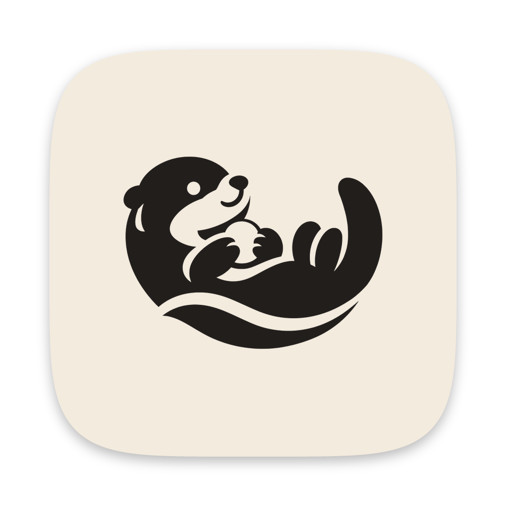
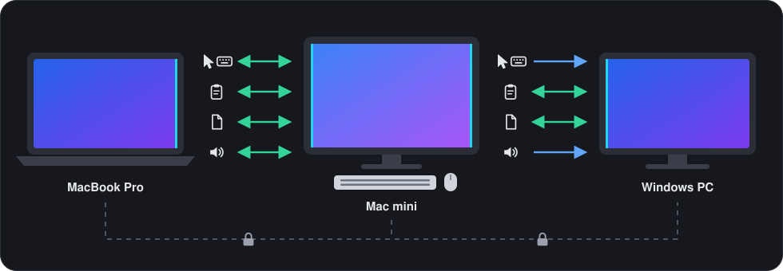
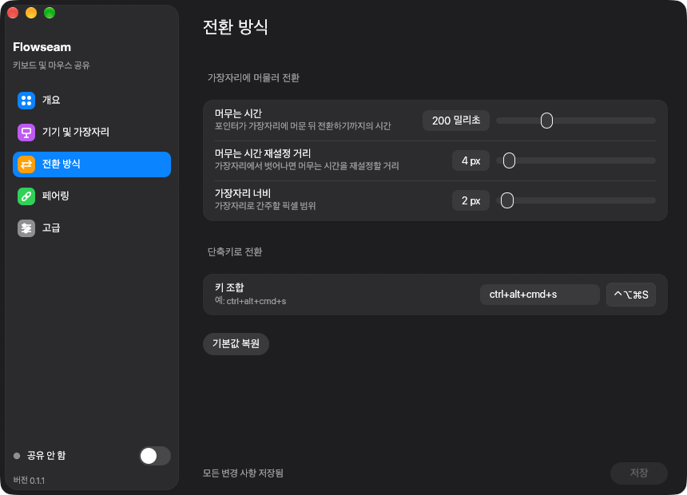
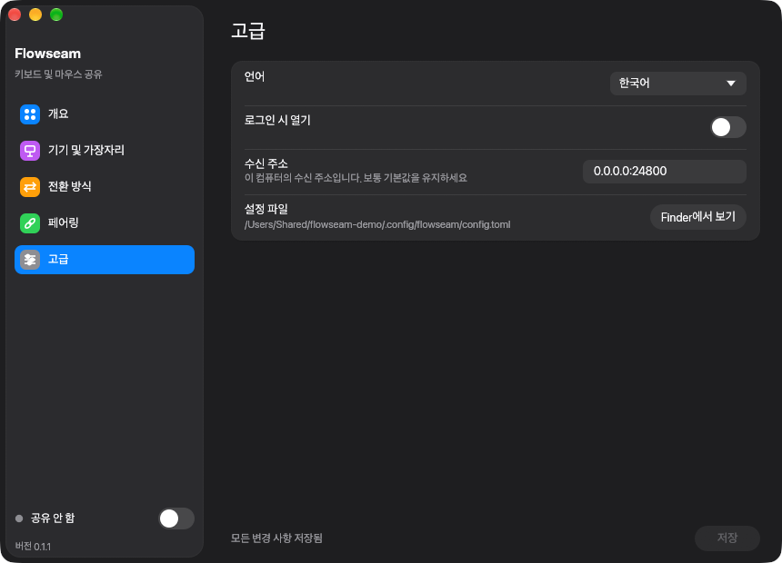

<!-- doctype: contract -->
<p align="center"></p>

<h1 align="center">Flowseam</h1>

<p align="center"><b>Mac과 PC 여러 대를 키보드 하나와 마우스 하나로.</b></p>

<p align="center"><a href="LICENSE"></a>   <a href="https://github.com/operonlab/flowseam/releases"></a></p>

<p align="center"><a href="README.md">English</a> · <a href="README.zh-TW.md">繁體中文</a> · <a href="README.ja.md">日本語</a> · 한국어</p>

포인터를 한 화면의 가장자리 밖으로 밀면 다음 컴퓨터로 이어집니다. 입력하는 내용은 포인터를 따라가고,
클립보드와 끌어다 놓는 파일도 함께 이동합니다. 기기끼리 직접 통신하므로 서버도 계정도 필요 없습니다.

https://github.com/user-attachments/assets/be5499eb-c39a-4722-b87a-0203b3a30c64

<sub>데모 영상의 내레이션과 음악은 ElevenLabs(elevenlabs.io)로 생성했습니다.</sub>

> **상태: 초기 단계(0.1).** Mac 두 대와 Windows PC 한 대에서 매일 사용하고 있습니다. 완성도가 거칠 수 있으니
> 모든 기기를 같은 버전으로 유지하세요.

<p align="center"></p>

## 가장자리를 넘는 것

| | Mac ↔ Mac | Mac ↔ Windows PC |
|---|:-:|:-:|
| 포인터와 키보드 | ⇄ | → |
| 클립보드 텍스트 | ⇄ | ⇄ |
| 파일, 놓은 위치에 저장 | ⇄ | ⇄ |
| 음량 및 미디어 키 | ⇄ | → |

⇄ 양방향 · → Mac에서만. Windows PC는 제어받는 쪽이며 다른 컴퓨터를 제어하지 못합니다. Mac으로 제어하는
동안에는 파일이 Windows PC에서도 돌아옵니다.

## 차별점

- **의도해서 전환.** 공유된 가장자리에 포인터를 200 ms 동안 두거나 ⌃⌥⌘S를 누릅니다. 마우스 버튼을 누르고
  있는 동안에는 포인터가 현재 화면에 머물기 때문에, 창을 끌거나 텍스트를 선택하다가 다음 컴퓨터로
  넘어가는 일은 없습니다. 파일 끌어다 놓기만 예외입니다.
- **항상 돌아올 길이 있음.** ⌃⌥⌘Esc를 누르면 마우스와 키보드가 Mac으로 돌아옵니다. 백그라운드 프로세스가
  멈추거나 공유 중에 macOS가 권한을 회수해도 입력이 잠긴 채로 남지 않고 해제됩니다.
- **Windows에서 Mac 단축키 사용.** ⌘C는 복사, ⌘Tab은 앱 전환, ⌥ 단독 입력은 시작 메뉴 열기입니다.
  [키와 단축키](#키와-단축키)를 참고하세요.
- **Mac 간 가장 빠른 연결.** 두 Mac이 둘 이상의 네트워크로 연결되어 있으면 Flowseam은 가장 빠른 쪽을
  사용합니다. Thunderbolt나 이더넷을 Wi‑Fi보다 우선합니다.
- **프라이버시.** 6자리 코드로 한 번만 페어링하면, 이후의 모든 연결은 내 기기끼리의 상호 TLS입니다.
  텔레메트리는 없습니다. [개인정보 보호와 네트워크](#개인정보-보호와-네트워크)를 참고하세요.
- **방해하지 않는 동작.** 메뉴 막대 아이콘(Mac) 또는 트레이 아이콘(Windows)이 공유 켜짐 여부와 연결된
  컴퓨터를 보여 줍니다. 창을 닫아도 Flowseam은 계속 실행되며, 종료되거나 멈춘 백그라운드 프로세스는 다시
  시작됩니다.
- **네 가지 언어.** English, 繁體中文, 日本語, 한국어를 지원하며 시스템 언어를 따릅니다.

## 앱

| 개요 | 기기 및 가장자리 |
|---|---|
|  |  |
| **전환 방식** | **페어링** |
|  |  |
| **고급** | **Windows PC에서** |
|  |  |

## 설치

| | macOS 13 이상(Apple silicon 및 Intel) | Windows 10 또는 11 |
|---|---|---|
| 받기 | Homebrew, 또는 [Releases](https://github.com/operonlab/flowseam/releases)의 zip | 소스에서 빌드(아직 설치 프로그램 없음) |
| 허용 | 손쉬운 사용 및 입력 모니터링 | 요청 시 Windows 방화벽(TCP 24800) |
| 업데이트 | `brew upgrade --cask flowseam` | 새 버전을 빌드해 `flowseam.exe` 교체 |

### macOS

```sh
brew install --cask operonlab/tap/flowseam
```

Flowseam을 한 번 실행합니다. macOS가 **손쉬운 사용**과 **입력 모니터링** 권한을 요청합니다(시스템 설정 ›
개인정보 보호 및 보안). 둘 다 허용하세요. 모든 릴리스는 같은 인증서로 서명되므로 업데이트 후에도 권한이
유지됩니다.

Flowseam은 자체 인증서로 서명되어 있으며 Apple의 공증을 받지 않았습니다. Homebrew cask는 다운로드 격리
속성을 대신 해제해 줍니다. zip으로 설치하면 macOS가 첫 실행을 거부합니다. 이때 시스템 설정 › 개인정보 보호
및 보안을 열고 **그래도 열기**를 선택하세요.

### Windows

Rust(stable, MSVC 툴체인)로 빌드하세요.

```powershell
git clone https://github.com/operonlab/flowseam
cd flowseam
cargo build --release -p flowseam
.\target\release\flowseam.exe
```

Flowseam이 설정 창을 열고 트레이에 아이콘을 표시합니다. 요청이 나타나면 Windows 방화벽에서 허용하세요.
Mac은 TCP 포트 24800으로 접속합니다.

## 설정

| | 위치 | 할 일 |
|---|---|---|
| **1. 추가** | 각 컴퓨터의 **기기 및 가장자리** | **＋ 기기 추가**를 선택합니다. 이름, 주소(호스트 이름 또는 IP), 그리고 그 컴퓨터가 놓인 화면 가장자리를 입력합니다. |
| **2. 페어링** | **페어링** | 한쪽이 코드를 표시하고 다른 쪽이 입력합니다. 아래를 참고하세요. 페어링은 한 번만 하면 됩니다. |
| **3. 공유** | 창 또는 메뉴 막대 아이콘 | **키보드와 마우스 공유**를 켜고 포인터를 가장자리 너머로 밀어 보세요. |

페어링하려면, 코드를 표시할 컴퓨터(Windows PC, 또는 Mac 두 대를 페어링할 때는 어느 한쪽 Mac)에서 먼저
공유를 끄세요. 페어링에 같은 포트를 사용하기 때문입니다. **페어링**을 열어 상대 컴퓨터를 선택하고 **페어링
코드 표시**를 선택합니다. 다른 Mac에서는 **페어링**을 열어 처음 컴퓨터를 선택하고 코드를 입력하고 **페어링**을 선택한 다음
**저장**을 선택합니다.

## 키와 단축키

| Mac에서 | 동작 |
|---|---|
| 공유된 가장자리에 200 ms 동안 머물기 | 그 방향의 컴퓨터로 전환 |
| ⌃⌥⌘S | 가장자리에 머물지 않고 전환. 돌아오려면 다른 컴퓨터에서 한 번 더 누릅니다 |
| ⌃⌥⌘Esc | 마우스와 키보드를 이 Mac으로 되찾기 |

머무는 시간과 전환 단축키는 **전환 방식**에서 설정합니다. 다른 컴퓨터가 Mac의 키를 해석하는 방식은
컴퓨터마다 **기기 및 가장자리 › 키 매핑**에서 설정합니다.

| 키 매핑 | 용도 |
|---|---|
| 변환 안 함 | 다른 Mac |
| 키 위치 기준(⌥=Win, ⌘=Alt) | PC, 키를 PC 키보드에 있는 위치 그대로 사용 |
| Mac 단축키 | PC, 손에 익은 단축키 그대로 사용 |

**Mac 단축키**를 선택하면:

| Mac에서 | PC에서 |
|---|---|
| ⌘ + 키, ⌃ + 키 | Ctrl + 키 |
| ⌘Tab | Alt+Tab |
| ⌘Q | Alt+F4 |
| ⌘⇧Z | Ctrl+Y (다시 실행) |
| ⌘← ⌘→ | Home, End |
| ⌥← ⌥→, ⌥⌫ | Ctrl+← Ctrl+→, Ctrl+Backspace |
| ⌘Space | Win+S (검색) |
| ⌃⌘Q | Win+L (잠금) |
| ⌘M | Win+↓ (최소화) |
| ⌘⇧4, ⌘⇧5 | Win+Shift+S (캡처) |
| ⌘⌥Esc | Ctrl+Shift+Esc (작업 관리자) |
| ⌥ 단독 입력 | 시작 |

전체 표는 [`crates/flowseam-core/src/mac_shortcuts.rs`](crates/flowseam-core/src/mac_shortcuts.rs)에 있습니다.

## 개인정보 보호와 네트워크

| | 방식 |
|---|---|
| 페어링 | 한 컴퓨터에 표시된 6자리 코드를 다른 컴퓨터에서 입력, 한 번만 |
| 연결 | 상호 TLS, 페어링한 컴퓨터의 인증서에 고정 |
| 경로 | 로컬 네트워크 또는 직접 설정한 SSH 터널을 통한 직접 연결. 중간에 서버 없음 |
| 포트 | TCP 24800 |
| 텔레메트리 | 없음. 업데이트 확인은 Releases 페이지를 열거나, 실행 중인 앱을 Homebrew로 설치했다면 Homebrew를 실행합니다 |

## 알려진 제한 사항

- Windows PC는 제어받을 수만 있고 다른 컴퓨터를 제어할 수 없습니다.
- 클립보드는 텍스트만 전달합니다. 이미지, 서식 있는 텍스트, 파일은 전달하지 않습니다.
- Linux는 지원하지 않습니다.
- Windows에는 설치 프로그램과 서명된 빌드가 없으므로 소스에서 빌드해야 합니다.
- 컴퓨터는 입력한 주소로 찾으며, 로컬 네트워크에서의 자동 검색은 아직 지원하지 않습니다.

## 문제 해결

| 문제 | 확인할 것 |
|---|---|
| 포인터가 넘어가지 않음 | 공유가 켜져 있는지, 두 컴퓨터가 서로 연결된 상태로 표시되는지, 그리고 기기 및 가장자리에 설정한 가장자리 쪽으로 포인터를 미는지 확인하세요. |
| Mac에서 '시스템 권한 필요'가 표시됨 | 시스템 설정 › 개인정보 보호 및 보안 › 손쉬운 사용 및 입력 모니터링에서 Flowseam을 켠 다음 앱을 종료했다가 다시 여세요. |
| 로그 | macOS: `~/Library/Logs/Flowseam/worker.log`. Windows: `%LOCALAPPDATA%\Flowseam\worker.log`. 이전 실행의 로그는 `worker.log.1`로 보관됩니다. |
| 설정과 페어링 정보 | `~/.config/flowseam` (Windows에서는 `%USERPROFILE%\.config\flowseam`). |

## 소스에서 빌드

Rust stable이 필요합니다. `cargo test --workspace`는 macOS와 Windows에서 실행됩니다.
`scripts/make-app.sh <version>`은 Apple silicon과 Intel 모두를 위한 macOS 앱을 빌드하고 서명하며, 코드 서명
ID와 `cargo-about`(`cargo install cargo-about --locked --features cli`)이 필요합니다.

설계 노트는 [docs/](docs/)에 있습니다. 변경 내역은 [CHANGELOG.md](CHANGELOG.md)에 정리되어 있습니다.

## 라이선스

[MIT](LICENSE). Flowseam이 사용하는 오픈소스 라이브러리의 라이선스는 앱에 함께 포함되어 있습니다
(`Flowseam.app/Contents/Resources/THIRD-PARTY-NOTICES.html`).
