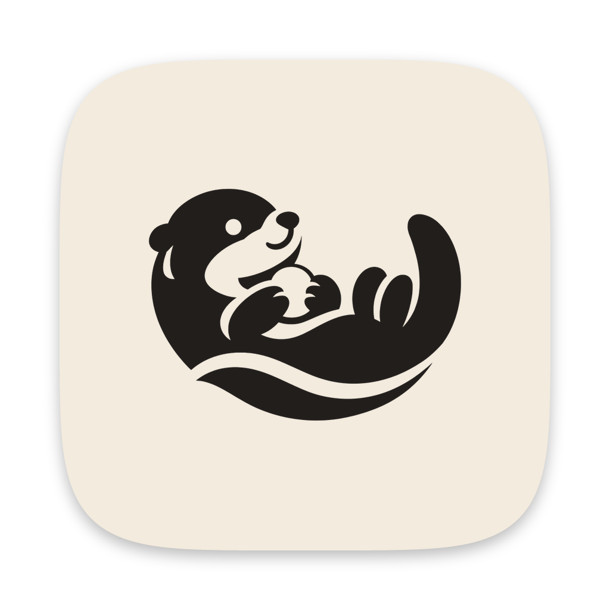
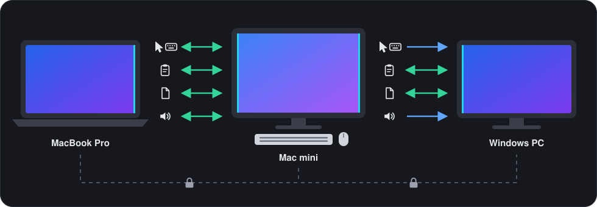
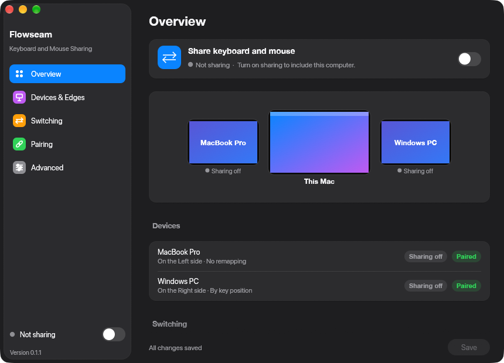
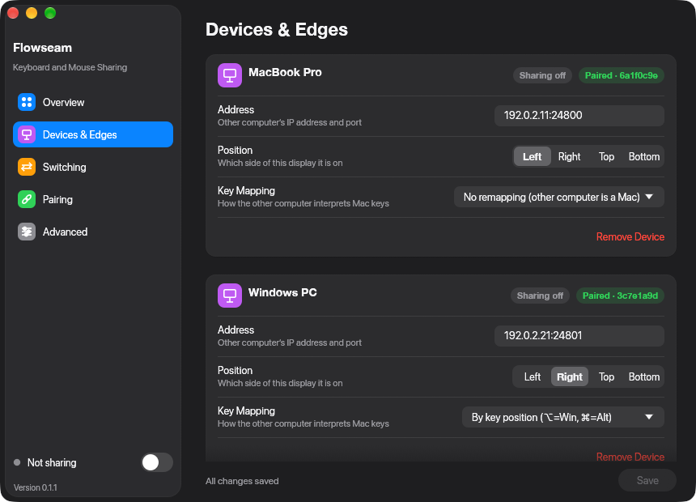
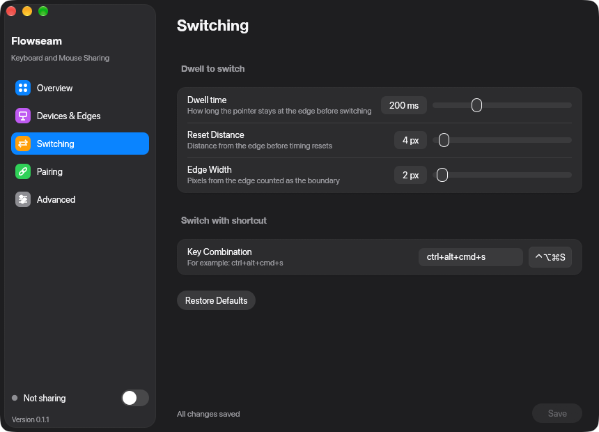
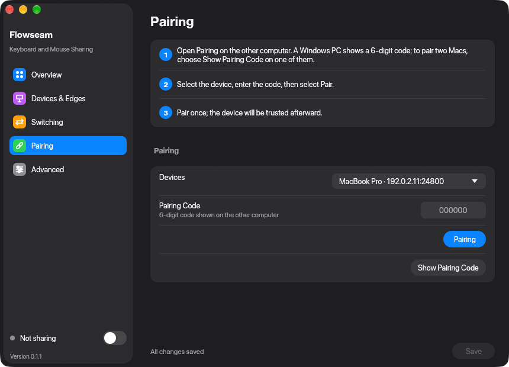
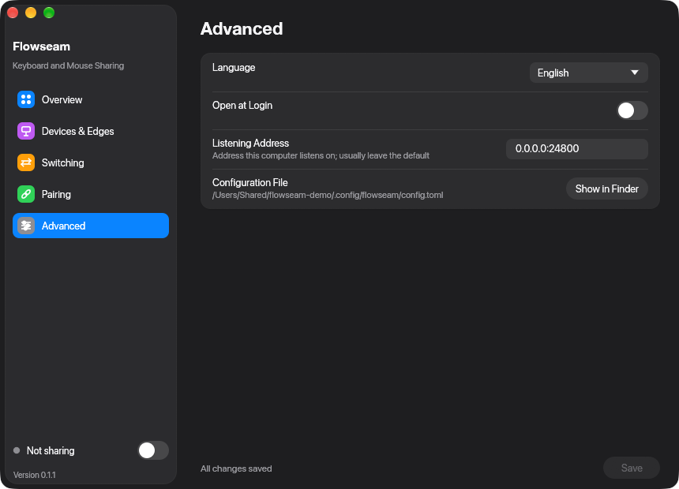
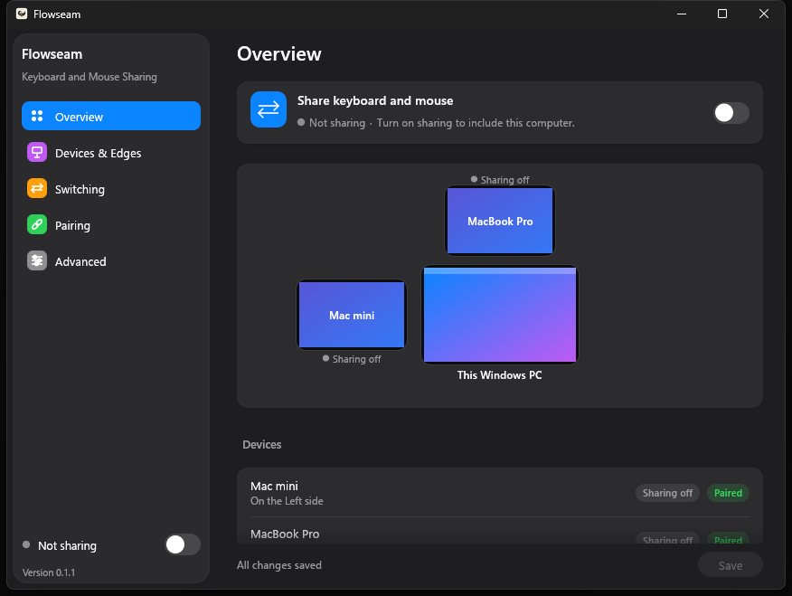

<!-- doctype: contract -->
<p align="center"></p>

<h1 align="center">Flowseam</h1>

<p align="center"><b>One keyboard and mouse across your Macs and PCs.</b></p>

<p align="center"><a href="LICENSE"></a>   <a href="https://github.com/operonlab/flowseam/releases"></a></p>

<p align="center">English · <a href="README.zh-TW.md">繁體中文</a> · <a href="README.ja.md">日本語</a> · <a href="README.ko.md">한국어</a></p>

Push the pointer off the edge of one screen and it carries on to the next computer. What you type follows
it, and so do the clipboard and the files you drag. The machines talk to each other directly: no server, no
account.

https://github.com/user-attachments/assets/be5499eb-c39a-4722-b87a-0203b3a30c64

<sub>Narration and music in the demo video were generated with ElevenLabs (elevenlabs.io).</sub>

> **Status: early (0.1).** Used every day on two Macs and a Windows PC. Expect rough edges, and keep every
> machine on the same version.

<p align="center"></p>

## What crosses the edge

| | Mac ↔ Mac | Mac ↔ Windows PC |
|---|:-:|:-:|
| Pointer and keyboard | ⇄ | → |
| Clipboard text | ⇄ | ⇄ |
| Files, dropped where you release them | ⇄ | ⇄ |
| Volume and media keys | ⇄ | → |

⇄ both ways · → from the Mac only. A Windows PC is controlled; it does not control another computer.
Files come back from it while a Mac drives it.

## What sets it apart

- **Switch on purpose.** Rest the pointer at a shared edge for 200 ms, or press ⌃⌥⌘S. While a mouse button is
  held the pointer stays on its screen, so dragging a window or selecting text never lands on the next
  computer. Dragging files is the one exception.
- **Through one Mac to the next.** A MacBook driving the Mac mini carries on through it to the Windows PC on
  its far side: the Mac in the middle passes the pointer and keys along.
- **Always a way back.** ⌃⌥⌘Esc returns the mouse and keyboard to the Mac. Touch the mouse or keyboard of a Mac
  that another computer is driving, and that Mac takes over. If the background process hangs, or macOS takes a
  permission away while sharing, input is released instead of staying locked.
- **Mac shortcuts on Windows.** ⌘C copies, ⌘Tab switches apps, tapping ⌥ opens Start. See
  [Keys and shortcuts](#keys-and-shortcuts).
- **The fastest link between Macs.** With more than one network between two Macs, Flowseam takes the
  fastest: Thunderbolt or Ethernet ahead of Wi‑Fi.
- **Private.** Pair once with a 6‑digit code; after that every connection is mutual TLS between your own
  machines. No telemetry. See [Privacy and network](#privacy-and-network).
- **Stays out of the way.** A menu bar icon (Mac) or tray icon (Windows) shows whether sharing is on and
  which computers are connected. Closing the window keeps Flowseam running, and a background process that
  dies or stalls is restarted.
- **Four languages.** English, 繁體中文, 日本語 and 한국어, following the system language.

## The app

| Overview | Devices & Edges |
|---|---|
|  |  |
| **Switching** | **Pairing** |
|  |  |
| **Advanced** | **On a Windows PC** |
|  |  |

## Install

| | macOS 13 or later (Apple silicon and Intel) | Windows 10 or 11 |
|---|---|---|
| Get it | Homebrew, or the zip from [Releases](https://github.com/operonlab/flowseam/releases) | The exe from [Releases](https://github.com/operonlab/flowseam/releases), or build from source (no installer yet) |
| Allow | Accessibility and Input Monitoring | Windows Firewall, when asked (TCP 24800) |
| Update | `brew upgrade --cask flowseam` | Download the new exe and replace the old one |

### macOS

```sh
brew install --cask operonlab/tap/flowseam
```

Open Flowseam once. macOS asks for **Accessibility** and **Input Monitoring** (System Settings › Privacy &
Security); allow both. Every release is signed with the same certificate, so updates keep the permissions.

Flowseam is signed with its own certificate, not notarized by Apple. The Homebrew cask clears the download
quarantine for you. If you install from the zip, macOS refuses the first launch: open System Settings ›
Privacy & Security and choose **Open Anyway**.

### Windows

Download `Flowseam-<version>-windows-x64.exe` from [Releases](https://github.com/operonlab/flowseam/releases), keep it in a folder of its own
(for example `%LOCALAPPDATA%\Programs\Flowseam`) and run it. The exe is not signed, so the first time Windows
SmartScreen says "Windows protected your PC": choose **More info**, then **Run anyway**.

To build it yourself instead, use Rust (stable, MSVC toolchain):

```powershell
git clone https://github.com/operonlab/flowseam
cd flowseam
cargo build --release -p flowseam
.\target\release\flowseam.exe
```

Flowseam opens its settings window and puts an icon in the tray. Let it through Windows Firewall when asked:
the Mac connects to it on TCP port 24800.

## Set up

| | Where | What to do |
|---|---|---|
| **1. Add** | **Devices & Edges**, on each computer | Choose **＋ Add Device**: a name, its address (host name or IP) and the screen edge it sits on. |
| **2. Pair** | **Pairing** | One computer shows a code and the other types it in; see below. Pairing happens once. |
| **3. Share** | The window, or the menu bar icon | Turn on **Share keyboard and mouse** and push the pointer across the edge. |

To pair, on the computer that shows the code (the Windows PC, or either Mac when you pair two Macs), turn
sharing off, since pairing uses the same port. Open **Pairing**, pick the other computer and choose **Show
Pairing Code**. On the other Mac, open **Pairing**, pick the first computer, type the code, choose **Pairing**, then
choose **Save**.

## Keys and shortcuts

| On the Mac | Does |
|---|---|
| Rest at a shared edge for 200 ms | Switch to the computer on that side |
| ⌃⌥⌘S | Switch over without resting at the edge; press it again on the other computer to come back |
| ⌃⌥⌘Esc | Take the mouse and keyboard back to this Mac |

The dwell time and the switch shortcut are set under **Switching**. How the other computer reads the Mac's
keys is set for each computer, under **Devices & Edges › Key Mapping**:

| Key Mapping | Use it for |
|---|---|
| No remapping | Another Mac |
| By key position (⌥=Win, ⌘=Alt) | A PC, with the keys where a PC keyboard has them |
| Mac shortcuts | A PC, with the shortcuts your hands already know |

With **Mac shortcuts**:

| On the Mac | On the PC |
|---|---|
| ⌘ + key, ⌃ + key | Ctrl + key |
| ⌘Tab | Alt+Tab |
| ⌘Q | Alt+F4 |
| ⌘⇧Z | Ctrl+Y (redo) |
| ⌘← ⌘→ | Home, End |
| ⌥← ⌥→, ⌥⌫ | Ctrl+← Ctrl+→, Ctrl+Backspace |
| ⌘Space | Win+S (search) |
| ⌃⌘Q | Win+L (lock) |
| ⌘M | Win+↓ (minimize) |
| ⌘⇧4, ⌘⇧5 | Win+Shift+S (snip) |
| ⌘⌥Esc | Ctrl+Shift+Esc (Task Manager) |
| ⌥, tapped alone | Start |

The full table is in [`crates/flowseam-core/src/mac_shortcuts.rs`](crates/flowseam-core/src/mac_shortcuts.rs).

## Privacy and network

| | How |
|---|---|
| Pairing | Once, with a 6‑digit code shown on one computer and typed on the other |
| Connection | Mutual TLS, pinned to the certificate of the computer you paired with |
| Route | Direct, over your local network or an SSH tunnel you set up. No server in between |
| Port | TCP 24800 |
| Telemetry | None. Check for Updates opens the Releases page, or runs Homebrew when Homebrew installed the copy you run |

## Known limitations

- A Windows PC can be controlled but cannot control another computer.
- The clipboard carries text only: no images, rich text or files.
- No Linux support.
- Windows has no installer, and its exe is not signed: SmartScreen warns the first time it runs.
- Computers are found by the address you enter; there is no discovery on the local network yet.

## Troubleshooting

| Problem | Check |
|---|---|
| The pointer will not cross | Sharing is on, both computers show each other as connected, and you push against the edge set under Devices & Edges. |
| A Mac shows "System Permission Required" | Turn Flowseam on under System Settings › Privacy & Security › Accessibility and Input Monitoring, then quit and reopen it. |
| Logs | macOS: `~/Library/Logs/Flowseam/worker.log`. Windows: `%LOCALAPPDATA%\Flowseam\worker.log`. The previous run is kept as `worker.log.1`. |
| Settings and pairings | `~/.config/flowseam` (on Windows, `%USERPROFILE%\.config\flowseam`). |

## Build from source

Rust stable. `cargo test --workspace` runs on macOS and Windows. `scripts/make-app.sh <version>` builds and
signs the macOS app for both Apple silicon and Intel; it needs a code-signing identity and `cargo-about`
(`cargo install cargo-about --locked --features cli`).

Design notes are in [docs/](docs/). Changes are listed in [CHANGELOG.md](CHANGELOG.md).

## License

[MIT](LICENSE). The licenses of the open-source libraries Flowseam is built from ship with the app, in
`Flowseam.app/Contents/Resources/THIRD-PARTY-NOTICES.html`.
