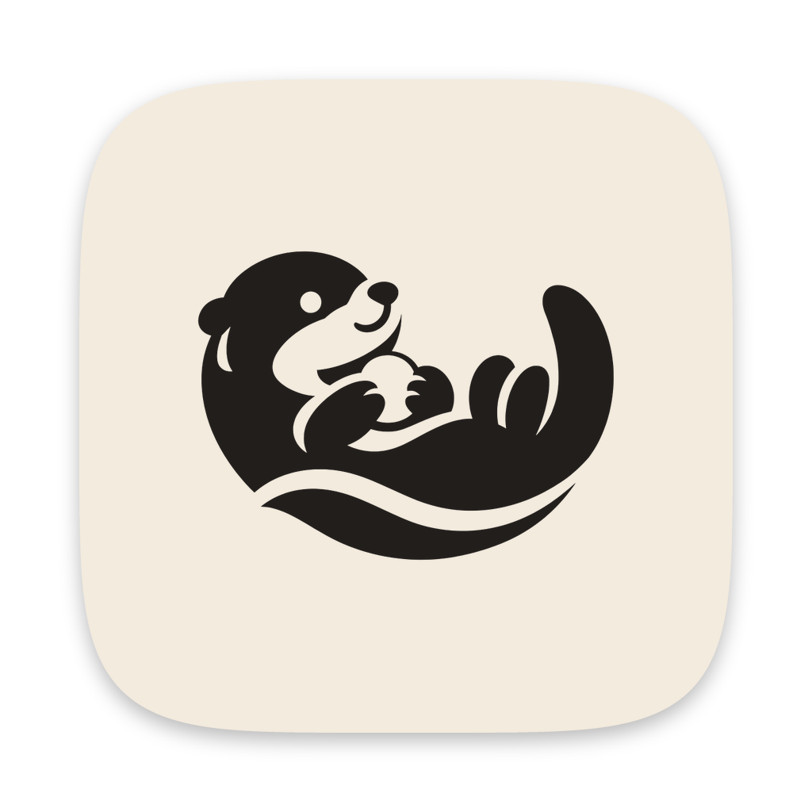
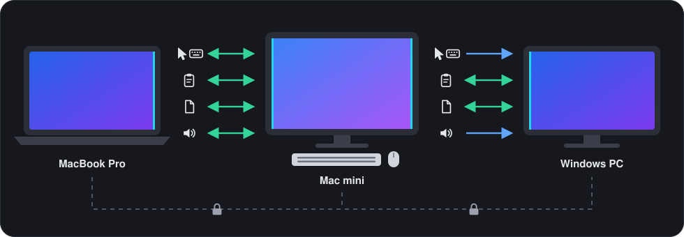
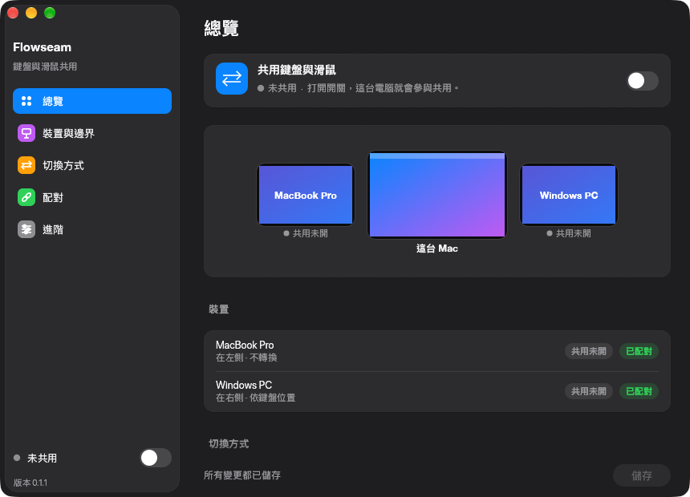
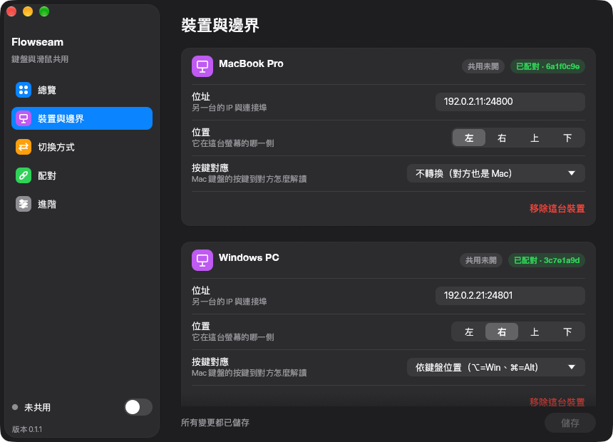
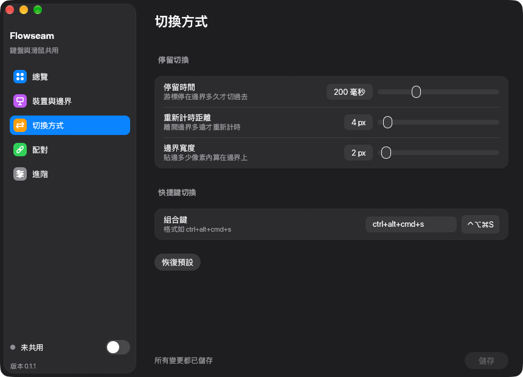
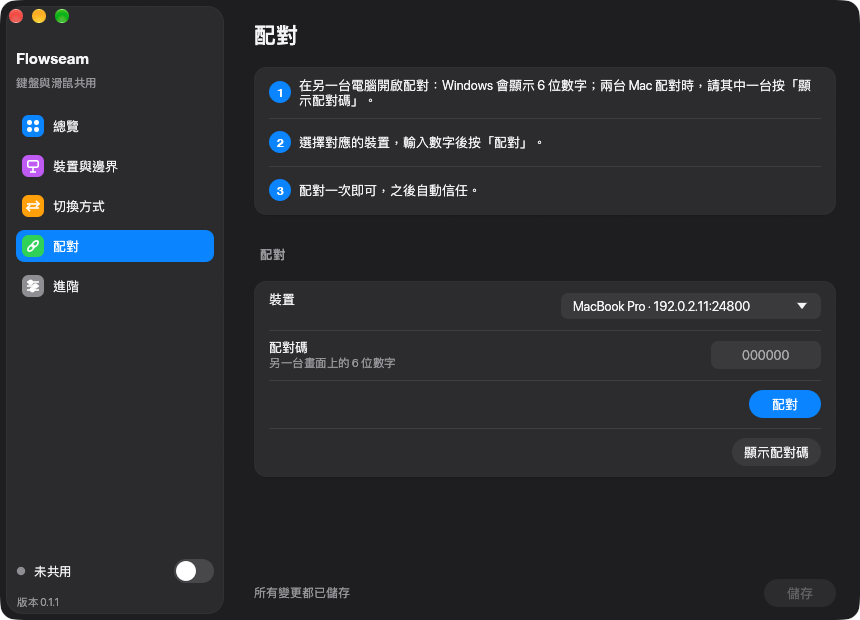
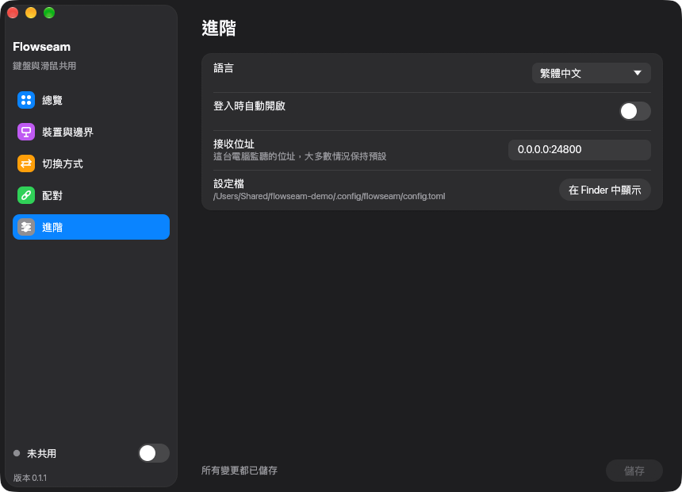
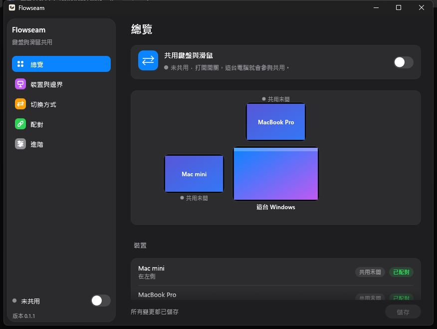

<!-- doctype: contract -->
<p align="center"></p>

<h1 align="center">Flowseam</h1>

<p align="center"><b>一組鍵盤與滑鼠，同時操作你的 Mac 與 PC。</b></p>

<p align="center"><a href="LICENSE"></a>   <a href="https://github.com/operonlab/flowseam/releases"></a></p>

<p align="center"><a href="README.md">English</a> · 繁體中文 · <a href="README.ja.md">日本語</a> · <a href="README.ko.md">한국어</a></p>

把游標推出一個螢幕的邊緣，就會接續出現在下一台電腦上。你輸入的內容跟著游標走，剪貼簿和你拖曳的檔案也一樣。機器之間直接互相通訊：不需要伺服器，也不需要帳號。

https://github.com/user-attachments/assets/be5499eb-c39a-4722-b87a-0203b3a30c64

<sub>示範影片的旁白與音樂由 ElevenLabs（elevenlabs.io）生成。</sub>

> **狀態：早期版本（0.1）。** 已在兩台 Mac 與一台 Windows PC 上每天使用。仍有不少粗糙之處，請讓每台機器都使用相同版本。

<p align="center"></p>

## 跨越邊緣的內容

| | Mac ↔ Mac | Mac ↔ Windows PC |
|---|:-:|:-:|
| 游標與鍵盤 | ⇄ | → |
| 剪貼簿文字 | ⇄ | ⇄ |
| 檔案，放開在哪裡就放在哪裡 | ⇄ | ⇄ |
| 音量與媒體鍵 | ⇄ | → |

⇄ 雙向 · → 只能從 Mac 出發。Windows PC 只能被控制，不能控制另一台電腦。由 Mac 操作它時，檔案可以從它那邊傳回來。

## 與眾不同之處

- **刻意才切換。** 讓游標在共用的邊緣停留 200 毫秒，或按下 ⌃⌥⌘S。按住滑鼠按鍵時，游標會留在原本的螢幕上，因此拖移視窗或選取文字時不會誤滑到下一台電腦；拖曳檔案是唯一的例外。
- **經過一台 Mac 控制下一台。** MacBook 操作 Mac mini 時，可以一路推到 Mac mini 另一側的 Windows PC：中間那台 Mac 會把游標和按鍵轉送過去。
- **永遠有退路。** 按 ⌃⌥⌘Esc 就能把滑鼠與鍵盤拿回這台 Mac。另一台電腦正在操作某台 Mac 時，碰一下那台 Mac 的滑鼠或鍵盤，就由它接手。如果背景程序當掉，或 macOS 在共用期間收回權限，輸入會被釋放，而不會一直被鎖住。
- **在 Windows 上使用 Mac 快捷鍵。** ⌘C 複製、⌘Tab 切換 App、單按 ⌥ 開啟「開始」功能表。詳見[按鍵與快捷鍵](#按鍵與快捷鍵)。
- **Mac 之間最快的連線。** 兩台 Mac 之間有多條網路相連時，Flowseam 會使用最快的一條：Thunderbolt 或乙太網路優先於 Wi‑Fi。
- **以隱私為設計原則。** 只需用 6 位數配對碼配對一次；之後的每個連線都是你自己機器之間的雙向 TLS。沒有任何遙測。詳見[隱私與網路](#隱私與網路)。
- **不擋你的路。** 選單列圖示（Mac）或系統匣圖示（Windows）會顯示共用是否開啟，以及哪些電腦已連線。關閉視窗後 Flowseam 仍會持續執行，背景程序如果當掉或停住，會自動重新啟動。Mac 上的 Dock 圖示與選單列圖示都可以關掉；再開一次 Flowseam 就會叫回視窗。
- **四種語言。** English、繁體中文、日本語與 한국어，跟隨系統語言。

## App 畫面

| 總覽 | 裝置與邊界 |
|---|---|
|  |  |
| **切換方式** | **配對** |
|  |  |
| **進階** | **在 Windows PC 上** |
|  |  |

## 安裝

| | macOS 13 或更新版本（Apple silicon 與 Intel） | Windows 10 或 11 |
|---|---|---|
| 取得 | Homebrew，或從 [Releases](https://github.com/operonlab/flowseam/releases) 下載 zip | 從 [Releases](https://github.com/operonlab/flowseam/releases) 下載 exe，或從原始碼建置（目前還沒有安裝程式） |
| 允許 | 輔助使用與輸入監控 | 出現提示時允許 Windows 防火牆（TCP 24800） |
| 更新 | `brew upgrade --cask flowseam` | 下載新的 exe，取代舊的 |

### macOS

```sh
brew install --cask operonlab/tap/flowseam
```

先開啟 Flowseam 一次。macOS 會要求**輔助使用**與**輸入監控**權限（系統設定 › 隱私權與安全性），請兩者都允許。每個版本都使用同一張憑證簽署，因此更新後權限會保留。

Flowseam 是以自己的憑證簽署，沒有經過 Apple 公證。Homebrew cask 會幫你移除下載時的隔離標記。如果你是用 zip 安裝，macOS 會拒絕第一次開啟：請打開「系統設定 › 隱私權與安全性」，然後選擇「**強制打開**」。

### Windows

從 [Releases](https://github.com/operonlab/flowseam/releases) 下載 `Flowseam-<version>-windows-x64.exe`，放在它自己的資料夾（例如 `%LOCALAPPDATA%\Programs\Flowseam`）後執行。這個 exe 沒有簽署，第一次執行時 Windows SmartScreen 會顯示「Windows 已保護您的電腦」：請選擇**其他資訊**，再選擇**仍要執行**。

也可以用 Rust（stable，MSVC 工具鏈）自行建置：

```powershell
git clone https://github.com/operonlab/flowseam
cd flowseam
cargo build --release -p flowseam
.\target\release\flowseam.exe
```

Flowseam 會開啟設定視窗，並在系統匣放上一個圖示。出現提示時，請讓它通過 Windows 防火牆：Mac 會透過 TCP 連接埠 24800 連到它。

## 設定步驟

| | 在哪裡 | 要做什麼 |
|---|---|---|
| **1. 加入** | 每台電腦上的**裝置與邊界** | 選擇**＋ 新增裝置**：填入名稱、位址（主機名稱或 IP），以及它所在的螢幕邊緣。 |
| **2. 配對** | **配對** | 由一台電腦顯示配對碼，另一台輸入；詳見下方說明。配對只需進行一次。 |
| **3. 共用** | 視窗，或選單列圖示 | 開啟**共用鍵盤與滑鼠**，然後把游標推過邊緣。 |

配對時，在顯示配對碼的那台電腦（Windows PC，或兩台 Mac 配對時的任一台）先關閉共用，因為配對會用到同一個連接埠。開啟**配對**，選擇另一台電腦，再選擇**顯示配對碼**。在另一台 Mac 上開啟**配對**，選擇第一台電腦，輸入配對碼後按**配對**，再按**儲存**。

## 按鍵與快捷鍵

| 在 Mac 上 | 作用 |
|---|---|
| 在共用的邊緣停留 200 毫秒 | 切換到那一側的電腦 |
| ⌃⌥⌘S | 不必在邊緣停留就切換過去；在另一台電腦上再按一次就會回來 |
| ⌃⌥⌘Esc | 把滑鼠與鍵盤拿回這台 Mac |

停留時間與切換快捷鍵在**切換方式**中設定。另一台電腦如何解讀 Mac 的按鍵，則是在每台電腦各自的**裝置與邊界 › 按鍵對應**中設定：

| 按鍵對應 | 適用於 |
|---|---|
| 不轉換 | 另一台 Mac |
| 依鍵盤位置（⌥=Win、⌘=Alt） | PC，按鍵位置對應 PC 鍵盤上的配置 |
| Mac 快捷鍵 | PC，沿用你的手早已熟悉的快捷鍵 |

使用 **Mac 快捷鍵**時：

| 在 Mac 上 | 在 PC 上 |
|---|---|
| ⌘ + 按鍵、⌃ + 按鍵 | Ctrl + 按鍵 |
| ⌘Tab | Alt+Tab |
| ⌘Q | Alt+F4 |
| ⌘⇧Z | Ctrl+Y（重做） |
| ⌘← ⌘→ | Home、End |
| ⌥← ⌥→、⌥⌫ | Ctrl+← Ctrl+→、Ctrl+Backspace |
| ⌘Space | Win+S（搜尋） |
| ⌃⌘Q | Win+L（鎖定） |
| ⌘M | Win+↓（最小化） |
| ⌘⇧4、⌘⇧5 | Win+Shift+S（截圖） |
| ⌘⌥Esc | Ctrl+Shift+Esc（工作管理員） |
| ⌥，單獨按一下 | 「開始」功能表 |

完整對照表在 [`crates/flowseam-core/src/mac_shortcuts.rs`](crates/flowseam-core/src/mac_shortcuts.rs)。

## 隱私與網路

| | 做法 |
|---|---|
| 配對 | 只需一次，由一台電腦顯示 6 位數配對碼，另一台輸入 |
| 連線 | 雙向 TLS，並綁定你當初配對的那台電腦的憑證 |
| 路徑 | 直接連線，經由你的區域網路，或你自己架設的 SSH 通道。中間沒有任何伺服器 |
| 連接埠 | TCP 24800 |
| 遙測 | 沒有 |
| 網路 | 預設只連你自己的電腦。在「進階」打開自動檢查更新後（預設關閉），每天向 api.github.com 查詢一次最新版本（查詢失敗時每小時重試） |
| 更新 | Flowseam 只會告訴你有新版，也可以略過某一版。檢查更新會開啟 Releases 頁面；如果你執行的這份是由 Homebrew 安裝的，則會執行 Homebrew |

## 已知限制

- Windows PC 可以被控制，但不能控制另一台電腦。
- 剪貼簿只傳送文字：不含圖片、格式化文字或檔案。
- 不支援 Linux。
- Windows 沒有安裝程式，exe 也沒有簽署：第一次執行時 SmartScreen 會警告。
- 電腦是依你輸入的位址找到的；目前還沒有在區域網路上自動探索的功能。

## 疑難排解

| 問題 | 檢查 |
|---|---|
| 游標過不去 | 共用已開啟、兩台電腦都顯示對方已連線，而且你推向的邊緣就是在裝置與邊界中設定的那一邊。 |
| Mac 上出現「需要系統權限」 | 到「系統設定 › 隱私權與安全性」的「輔助使用」與「輸入監控」，把 Flowseam 開啟，然後結束並重新開啟它。 |
| 記錄檔 | macOS：`~/Library/Logs/Flowseam/worker.log`。Windows：`%LOCALAPPDATA%\Flowseam\worker.log`。上一次執行的記錄會保留為 `worker.log.1`。 |
| 設定與配對資料 | `~/.config/flowseam`（Windows 上是 `%USERPROFILE%\.config\flowseam`）。 |

## 從原始碼建置

需要 Rust stable。`cargo test --workspace` 可在 macOS 與 Windows 上執行。`scripts/make-app.sh <version>` 會建置並簽署同時支援 Apple silicon 與 Intel 的 macOS App；需要有程式碼簽署身分，以及 `cargo-about`（`cargo install cargo-about --locked --features cli`）。

設計筆記在 [docs/](docs/)。變更紀錄列在 [CHANGELOG.md](CHANGELOG.md)。

## 授權

[MIT](LICENSE)。Flowseam 所使用的開源函式庫，其授權條款隨 App 一併提供，位於 `Flowseam.app/Contents/Resources/THIRD-PARTY-NOTICES.html`。
